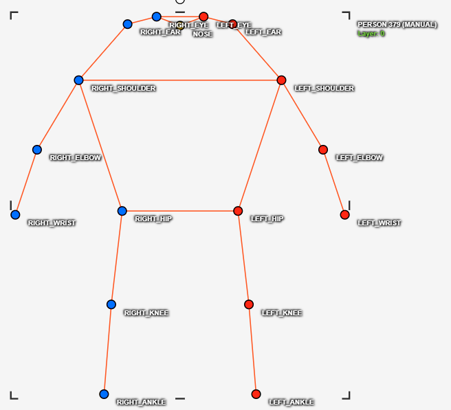
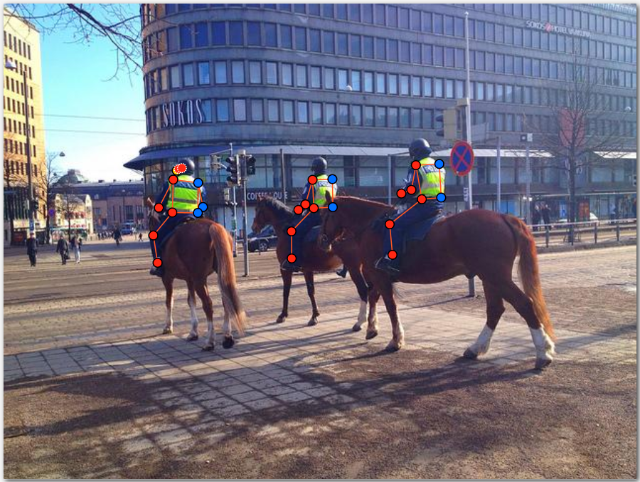
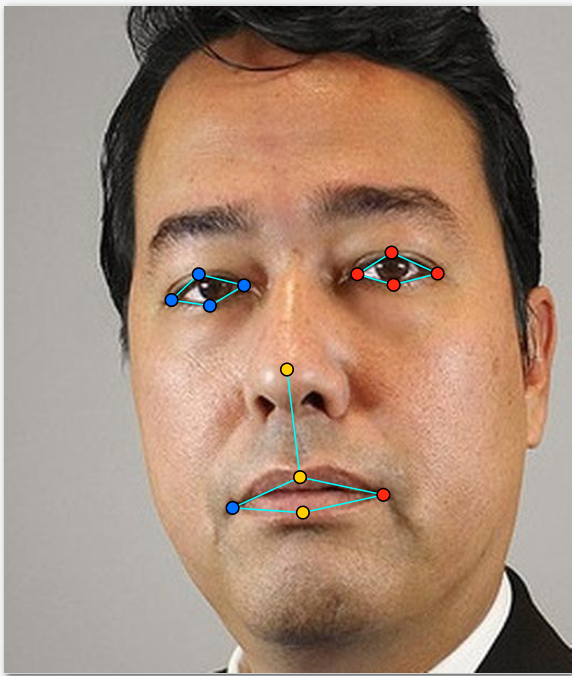
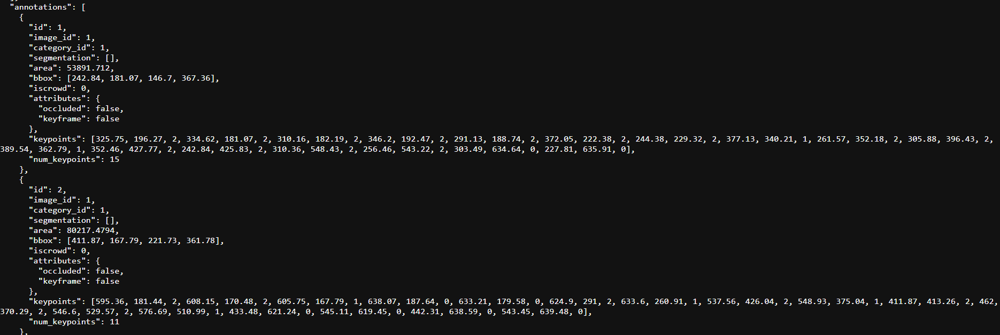

# Báo cáo cá nhân — HoVaTen-MSSV

Đổi tên file theo quy tắc `MSSV_HoTen.md`. Ví dụ: `20241234_NguyenVanAn.md`.

Dữ liệu: 12 ảnh người COCO val2017 (Lin et al., 2014) và 8 ảnh chân dung Wikimedia Commons, chỉ dùng trong lớp.

## 0. Thông tin học viên

- Họ tên: Phạm Hải
- MSSV: 202604047
- Email: stone23072004@gmail.com
- Link repository: https://github.com/PHai237/K5-L2B-DAY04-PhamHai-2A202604047-KeypointPose-Student
- Phiên bản CVAT (Help → About): 2.74.1
- Máy: hệ điều hành Windows · RAM 16 GB · chạy CVAT chế độ đầy đủ
- Bộ ảnh (`src/exports/assignment.json` do `lab.py setup` tạo): có
- Giờ bắt đầu: 17h
- Giờ kết thúc: 23h

## 1. Kiểm tra label (CP0)

| Label | Kiểu | Số điểm | Tên điểm đúng bảng của lab? | Đúng thứ tự? | Số cạnh |
|---|---|---:|---|---|---:|
| `person` | Skeleton | 17 | Có | Có | 19 |
| `face` | Skeleton | 13 | Có | Có | 13 |

Mẫu `person` dựng theo người quay mặt về camera (các điểm `left_*` nằm bên phải khung mẫu)? Đúng

Cách đổi cờ `occluded` / `outside` cho **một điểm** trên phiên bản CVAT này (một câu): Rê chuột vào keypoint cần chỉnh, nhấn `Q` để đánh dấu `occluded` hoặc `O` để đánh dấu `outside`

...

## 2. Số lượng đã gán và thời gian (CP1, CP2)

| Nhóm ảnh | Số ảnh | Số skeleton đã gán | Số người dưới 60 px (không gán) | Số poster / gương / màn hình bỏ qua | Thời gian (phút) |
|---|---:|---:|---:|---:|---:|
| `easy` | 5 | 5 | 0 | 1 | 30 |
| `occluded` | 6 | 5 | 7 | 1 | 30 |
| `back` | 2 | 4 | 2 | 0 | 15 |
| `small` | 1 | 3 | 0 | 0 | 7 |
| `crowd` | 1 | 3 | 0 | 0 | 8 |
| `faces` | 8 | 8 | — | 0 | 20 |

- Số ảnh người đã xong ở mốc phút 105: 10 / 10
- Thời gian thực tế (phút): CP1 90 · CP2 20 · CP3 20
- Ảnh tốn thời gian nhất là ảnh nào, vì sao? Ảnh 000000269462.jpg, vì người cưỡi ngựa bị che gần hết phần thân bên phải

...

## 3. Bảng ca khó (CP1, CP2)

Mỗi điểm bạn phân vân một dòng, nhất là phân vân giữa `v = 1` và `v = 0`, hoặc không chắc hướng người.

| Ảnh | Người / mặt | Điểm | Cờ đã chọn | Phân vân giữa | Lý do chọn |
|---|---|---|---:|---|---|
| 000000056651.jpg | Người áo hồng | right_wrist | occluded | occluded và outside | Có thể căn được cổ tay |
| 000000269462.jpg | Người cưỡi ngựa bên trái ngoài cùng | left_ear | occluded | occluded và outside | Dựa theo mũ nên em vẫn căn cho tai |

## 4. Bảng tự review (CP3)

Đi từ ảnh cuối về ảnh đầu. 5 ảnh người (ít nhất 2 ảnh `back` hoặc `crowd`) và 3 ảnh mặt. Ít nhất 8 dòng, kể cả dòng `ok`. Ghi lỗi trước, sửa sau.

Mã lỗi dùng đúng một trong: `lr_swap`, `vis_flag`, `position`, `missing`, `extra`, `ok`.

| Ảnh | Người / mặt | Điểm | Mã lỗi | Ghi chú | Đã sửa? |
|---|---|---|---|---|---|
| 000000309169.jpg | Người phụ nữ áo vàng | right_shoulder và left_shoulder | lr_swap | Gán nhầm 2 bên vai | Có |
| 000000292999.jpg | Người đàn ông cầm gậy | - | ok | - | Không |
| 000000269462.jpg | Người cưỡi ngựa bên phải ngoài cùng | right_shoulder và left_shoulder | lr_swap | Gán nhầm 2 bên vai | Có |
| 000000123544.jpg | Người mặc áo số 23 | right_knee | position | Gán nhầm vị trí | Có |
| 000000103970.jpg | Người lướt sóng | - | ok | - | Không |
| face_496353.jpg | Mặt đang cười | - | ok | - | Không |
| face_490361.jpg | Mặt đang cười | - | ok | - | Không |
| face_145621.jpg | Mặt đang cười | - | ok | - | Không |

Tổng hợp số lỗi theo mã:

| `lr_swap` | `vis_flag` | `position` | `missing` | `extra` | `ok` |
|---:|---:|---:|---:|---:|---:|
| 2 | 0 | 1 | 0 | 0 | 5 |

Điểm còn phân vân giữa `v = 1` và `v = 0` (ghi cả hai lựa chọn và lý do chọn): 0

...

## 5. Kiểm file xuất và kết quả tự kiểm (CP4)

Tự kiểm tay trong file JSON:

| File | Người / mặt kiểm (ảnh, thứ tự) | Số phần tử `keypoints` | Điểm `outside` ra `v = 0`, `occluded` ra `v = 1`? | `num_keypoints` khớp? |
|---|---|---:|---|---|
| `PhamHai_persons.zip` | `000000056651.jpg`, #1 | 51 | Có (`v=0`: 2, `v=1`: 2) | Có (15) |
| `PhamHai_persons.zip` | `000000269462.jpg`, #1 | 51 | Có (`v=0`: 9, `v=1`: 0) | Có (8) |
| `PhamHai_faces.zip` | `face_496353.jpg`, #1 | 39 | Có (`v=0`: 0, `v=1`: 0) | Có (13) |

Sau khi xuất, CVAT ghi `occluded` thành `v = 1` và `outside` thành `v = 0`. Tọa độ của điểm `outside` trong file là `0, 0` hay tọa độ cũ? Có 47 điểm `v=0` trong file Persons vẫn giữ tọa độ cũ.

Hai job đã chuyển sang completed trên CVAT? Có.

Dán phần **TÓM TẮT** in ra từ `src/check_submission.py`:

```text
- File person: PhamHai_persons.zip
  Số ảnh: 12 · số skeleton `person`: 21 · mỗi annotation 51 số
  Skeleton theo ảnh: 000000056651=2, 000000072098=1, 000000103970=1, 000000123544=2, 000000156986=2, 000000196283=1, 000000201702=1, 000000269462=3, 000000292999=1, 000000309169=3, 000000311497=2, 000000431988=2
  Cờ v: v=2 281 (79%) · v=1 29 (8%) · v=0 47 (13%)
  num_keypoints trung bình: 14.8
- File face: PhamHai_faces.zip
  Số ảnh: 8 · số skeleton `face`: 8 · mỗi annotation 39 số
  Skeleton theo ảnh: face_13874=1, face_145621=1, face_168953=1, face_415073=1, face_490361=1, face_496353=1, face_559185=1, face_92028=1
  Cờ v: v=2 104 (100%) · v=1 0 (0%) · v=0 0 (0%)
  num_keypoints trung bình: 13.0
- Ghi chú: 47 điểm v = 0 vẫn mang tọa độ cũ (CVAT 2.x xuất như vậy; chuẩn COCO ghi 0, 0). Không phải lỗi: điểm v = 0 bị bỏ qua khi huấn luyện và khi chấm.
- Số [LỖI]: 0 · số [CẢNH BÁO]: 5
Kết quả: ĐẠT (đọc lại từng cảnh báo ở trên)
```

Các `[CẢNH BÁO]` còn giữ nguyên và lý do:

Script ghi nhận 5 cảnh báo hình học:

- `000000056651.jpg` #1: cặp `wrist`.
- `000000123544.jpg` #2: cặp `hip`, `knee`.
- `000000292999.jpg` #1: cặp `elbow`.
- `000000309169.jpg` #1: cặp `hip`, `knee`, `ankle`.
- `000000311497.jpg` #1: cặp `knee`, `ankle`.

Các trường hợp này có thể do đảo trái/phải hoặc tư thế bắt chéo. Nguyên nhân cụ thể chưa được xác nhận chỉ bằng kiểm tra JSON.

...

## 6. Ảnh chụp màn hình

1. Label `person` trong label constructor (đủ 17 điểm có tên):

   

2. Một người quay lưng đã gán, cờ đã đặt:

   

3. Một khuôn mặt đã gán 13 điểm, phóng to vùng mắt:

   

4. Một đoạn JSON xuất của một người:

   

Nguồn ảnh: COCO 2017 (Lin et al., 2014); ảnh chụp màn hình từ CVAT và dữ liệu COCO Keypoints 1.0 xuất từ CVAT.

## 7. Tự đánh giá

1. Lỗi bạn mắc nhiều nhất hôm nay, và cách bạn sẽ tránh ở dự án thật: Lỗi em mắc nhiều nhất là lr_swap, và em sẽ tránh bằng cách chú ý kỹ hơn trong dự án thật

   ...

2. Một quy tắc bạn đề xuất thêm vào guideline (kèm ảnh ví dụ nếu có): Trong guideline em thấy có quy tắc là dưới 60px thì không gán, nhưng em nghĩ là nếu trong trường hợp tầm 50px vẫn nhìn rõ thì vẫn có thể gán

   ...

3. Nhãn của bạn đi vào model ở đâu? Chọn một lỗi bạn đã sửa và nói nó sẽ làm model học sai thế nào (heatmap, trọng số trong loss, hay bước lật ảnh): ở ảnh 000000309169.jpg, em đã sửa lỗi lr_swap do đánh dấu ngược 2 vai, model sử dụng toạ độ sai thì khi lật ảnh, nó sẽ bị sai thông tin về 2 vị trí này

   ...

## 8. Khó khăn và lỗi kỹ thuật

Khó khăn lớn nhất của em là xác định đúng các điểm trái/phải khi người có tư thế phức tạp hoặc bị che khuất. Trong quá trình tự review, em đã phát hiện và sửa hai lỗi `lr_swap` ở vai và một lỗi `position` ở đầu gối. Những trường hợp nhiều người chồng lấn cũng khiến em phải kiểm tra kỹ hơn trước khi lưu.

Về kỹ thuật, file xuất COCO Keypoints 1.0 đã vượt qua script tự kiểm với 0 lỗi. Tuy nhiên, script vẫn đưa ra một số cảnh báo hình học cần kiểm tra trực quan để xác định có phải lỗi gán nhãn hay do tư thế thực tế của người trong ảnh.

## Bonus (nếu làm)

### B1 — 3 ảnh người khó thêm

| Ảnh | Số skeleton | Số người dưới 60 px | Ca khó nhất |
|---|---:|---:|---|
| `000000373426.jpg` | 3 | Chưa thống kê | Ba người trong cảnh bóng chày có các bộ phận cơ thể chồng lấn |
| `000000507223.jpg` | 3 | Chưa thống kê | Người cúi gập cơ thể khiến việc xác định các khớp chân khó hơn |
| `000000565600.jpg` | 2 | Chưa thống kê | Người phía trước che một phần vận động viên tennis; cần kiểm tra thêm người áo trắng phía sau |

Kết quả `src/check_submission.py` cho `PhamHai_bonus_persons.zip`:

```text
- File person: PhamHai_bonus_persons.zip
  Số ảnh: 3 · số skeleton `person`: 8 · mỗi annotation 51 số
  Skeleton theo ảnh: 000000373426=3, 000000507223=3, 000000565600=2
  Cờ v: v=2 93 (68%) · v=1 12 (9%) · v=0 31 (23%)
  num_keypoints trung bình: 13.1
- Ghi chú: 31 điểm v = 0 vẫn mang tọa độ cũ (CVAT 2.x xuất như vậy; chuẩn COCO ghi 0, 0). Không phải lỗi: điểm v = 0 bị bỏ qua khi huấn luyện và khi chấm.
- Số [LỖI]: 0 · số [CẢNH BÁO]: 1
Kết quả: ĐẠT (đọc lại từng cảnh báo ở trên)
```

### B2 — 5 ảnh khuôn mặt đen trắng / hồng ngoại

Ảnh không màu khó hơn ở điểm nào? Kính râm trên ảnh hồng ngoại có còn là `v = 1` không?

Theo em, ảnh đen trắng khó hơn vì không có thông tin màu sắc để hỗ trợ phân biệt các vùng trên khuôn mặt. Ở một số ảnh có độ tương phản thấp, việc xác định chính xác mép mí mắt và khóe miệng cũng khó hơn.

Đối với kính râm trong ảnh hồng ngoại, em nghĩ không phải lúc nào cũng đặt `v = 1`. Nếu nhìn thấy rõ mắt thì vẫn có thể đặt `v = 2`. Nếu mắt bị kính che nhưng xác định được vị trí tương đối chắc chắn thì dùng `v = 1`. Nếu không thể xác định được vị trí đáng tin cậy thì dùng `v = 0`.

### B3 — Model so với nhãn của tôi (không tính điểm)

- Demo đã dùng: Không thực hiện.
- Ảnh đã thử: Không thực hiện.

1. Model có trả điểm cho khớp bị che, hay khớp ngoài ảnh không? Confidence ở các điểm đó thế nào?

   Không thực hiện Bonus B3.

2. Với người quay lưng, model có đổi trái/phải không?

   Không thực hiện Bonus B3.

3. Bộ điểm của model có giống 17 điểm COCO không?

   Không thực hiện Bonus B3.

   ...

## 9. Tài liệu tham khảo và công cụ AI đã dùng

### Tài liệu tham khảo

1. `README.md` — Tổng quan Lab Ngày 4: Keypoint & Pose.
2. `RULES.md` — Quy định thực hành và liêm chính học thuật.
3. `CHECKPOINTS.md` — Các checkpoint CP0–CP4.
4. `RUBRIC.md` — Tiêu chí đánh giá và Bonus.
5. `SUBMISSION.md` — Yêu cầu báo cáo và nộp bài.
6. `docs/GUIDELINE.md` — Quy ước gán keypoint, hướng trái/phải và visibility.
7. `docs/COCO_KEYPOINTS.md` — Cấu trúc định dạng COCO Keypoints 1.0.
8. `src/check_submission.py` — Script kiểm tra dữ liệu xuất.

### Công cụ đã sử dụng

**CVAT (Computer Vision Annotation Tool):**
- Gán thủ công skeleton 17 keypoint cho người và 13 keypoint cho khuôn mặt.
- Điều chỉnh tọa độ, visibility và xuất annotation theo định dạng COCO Keypoints 1.0.

**Python và công cụ kiểm tra của Lab:**
- `lab.py`: thiết lập và xuất dữ liệu.
- `check_submission.py`: kiểm tra cấu trúc dữ liệu, số lượng annotation, visibility và cảnh báo hình học.

**ChatGPT (OpenAI):**
- Hỗ trợ giải thích các khái niệm về COCO Keypoints, visibility và kiểm tra trái/phải.
- Hỗ trợ đọc, diễn giải log và cảnh báo từ script tự kiểm.
- Hỗ trợ thống kê dữ liệu xuất và trình bày những phần báo cáo được phép theo `RULES.md`.
- Không sử dụng để sinh tọa độ keypoint hoặc auto-annotation.

...
